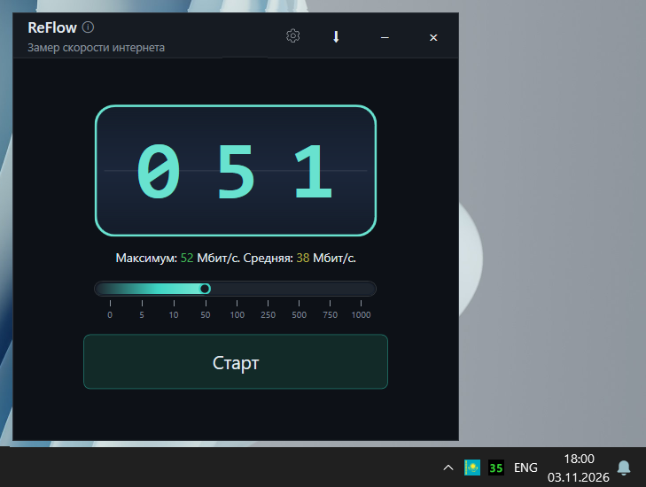

# ReFlow

**English** · [Русский](#русский)

A tiny, good-looking internet speed test for Windows — with a speedometer, a one-click test right from the system tray, and your country flag in the tray.



## Download

Get the latest `ReFlow.exe` on the [Releases](../../releases) page.  
It is a **self-contained** build — no need to install .NET.

## Features

- **Speedometer and graph** — live speed, maximum and average for the test
- **Test from the tray** — speed digits right on the tray icon; single click runs a quick test, double click opens the window (can be swapped)
- **Waits for the network** — if there is no internet, the app waits for it and starts the test by itself
- **Country flag** — shows the country of your external IP in the main window and as a second tray icon; checks on network change, on click or on a timer
- **Enhanced mode behind a VPN** — an extra request that bypasses the VPN shows your real country
- **Sound when the network is back** — a short tune when the internet returns during a test
- **Test duration** — 10 / 30 / 60 seconds or your own value
- **Autostart and auto test** — starts with Windows, minimizes to the tray, runs a test on startup
- **Your own test file** — you can set a link to a file on your own server
- **Languages** — English and Russian

## Building from source

**Requires:** [.NET 6 SDK](https://dotnet.microsoft.com/download/dotnet/6.0) (or newer).

```bash
# Clone the repository
git clone https://github.com/dinosmike/ReFlow.git
cd ReFlow

# Publish a single executable (self-contained)
dotnet publish ReFlow/ReFlow.csproj -c Release -r win-x64 --self-contained true ^
    -p:PublishSingleFile=true -p:IncludeNativeLibrariesForSelfExtract=true ^
    -p:EnableCompressionInSingleFile=true -p:DebugType=None -o publish

# Or just run the script
build-release.bat
```

The ready `ReFlow.exe` is in the `publish/` folder.

## Stack

- **WPF** (.NET 6, Windows only)
- **Windows Forms NotifyIcon** — tray icons
- **flag-icons** (MIT) — country flags

## License

Provided "as is" for personal and educational use.

## Author

**Mikhail Krylov** — [Telegram](https://t.me/mihail_krylov) · [GitHub](https://github.com/dinosmike)

---

## Русский

Небольшая, но очень красивая утилита для замера скорости интернета — со спидометром, замером прямо из трея и флагом страны в трее.

## Скачать

На странице [Releases](../../releases) возьмите последний `ReFlow.exe`.  
Сборка **self-contained** — отдельно ставить .NET не нужно.

## Возможности

- **Спидометр и график** — скорость в реальном времени, максимум и средняя за замер
- **Замер из трея** — цифры скорости прямо на иконке; клик — быстрый замер, двойной клик — окно (можно поменять местами)
- **Ожидание сети** — если интернета нет, программа ждёт его и начинает замер сама
- **Флаг страны** — страна по внешнему IP в главном окне и второй иконкой в трее; проверка при смене сети, по клику или по таймеру
- **Усиленный режим при VPN** — дополнительный запрос в обход VPN показывает реальную страну
- **Звук при появлении сети** — короткая мелодия, когда во время замера вернулся интернет
- **Длительность замера** — 10 / 30 / 60 секунд или своё значение
- **Автозапуск и авто-замер** — старт вместе с Windows, сворачивание в трей, замер при запуске
- **Свой файл для замера** — можно указать ссылку на файл на своём сервере
- **Локализация** — русский и английский

## Сборка из исходников

**Нужно:** [.NET 6 SDK](https://dotnet.microsoft.com/download/dotnet/6.0) (или новее).

```bash
# Клонировать репозиторий
git clone https://github.com/dinosmike/ReFlow.git
cd ReFlow

# Опубликовать один исполняемый файл (self-contained)
dotnet publish ReFlow/ReFlow.csproj -c Release -r win-x64 --self-contained true ^
    -p:PublishSingleFile=true -p:IncludeNativeLibrariesForSelfExtract=true ^
    -p:EnableCompressionInSingleFile=true -p:DebugType=None -o publish

# Или просто запустить скрипт
build-release.bat
```

Готовый `ReFlow.exe` лежит в папке `publish/`.

## Стек

- **WPF** (.NET 6, только Windows)
- **Windows Forms NotifyIcon** — иконки в трее
- **flag-icons** (MIT) — флаги стран

## Лицензия

Проект распространяется «как есть» для личного и учебного использования.

## Автор

**Михаил Крылов** — [Telegram](https://t.me/mihail_krylov) · [GitHub](https://github.com/dinosmike)
